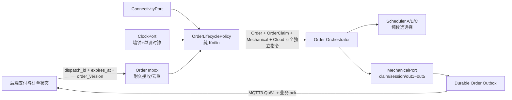

# 第三阶段：断网订单边界审计与 3A 最小切片方案

日期：2026-08-13
上位机源码基线：`versionName=2.5.42`、`versionCode=292`、`fad00d530bb88c0fb3ace82dcdda038f24626438`
后端审计基线：`bfaebdad8ad7553d0d254069aa0cd686eeb6b570`
说明：版本号仅代表当前源码，不代表现场 APK。

后端工作树存在用户未提交的文档改动；本阶段对后端严格只读，不覆盖、不回滚，也不把这些改动计入本方案实现范围。

重构工作树已包含第一、二阶段尚未提交的 App 接线、`scheduler-core` 和 `recovery-core` 改动。下文 3A 文件白名单只约束“第三阶段相对进入 3A 前快照新增的差异”，不得把前序阶段改动误删、覆盖或回滚。

## 1. 目标与本阶段边界

本阶段回答三个问题：

1. 没有网络时，什么订单绝不能启动机械出餐；
2. 已付款订单已经被设备接受或已经开始机械动作后，网络中断应如何处理；
3. 现有订单代码怎样逐步从 Activity、MQTT、单例和机械动作中拆出纯核心，而不重写现有主链路。

本方案保持以下边界：

- 不改下位机程序、Modbus 寄存器、300/400 动作组或 out1~out5 语义；
- 不升级 MQTT 5；继续使用 MQTT 3/QoS 1，并在后续独立切片增加业务级 dispatch ack；
- 不把 `onlineStatus` 当网络连接状态；
- 不在 3A 改变接单、退款、机械动作或 UI 行为；
- 不提交、不推送、不发布、不部署、不操作设备。

## 2. 静态源码事实

### 2.1 服务端只在已支付运行单条件满足后尝试下发

当前后端 `MpOrderService.scheduleSuccessPayOrderAfterCommit` 在事务提交后重新读取订单，并要求：

- `payStatus == "1"`；
- `status == "1"`；
- 出餐前库存复核通过；
- MQTT 下发护栏先落库。

满足后调用 `MqttHelper.successPayOrder`，按 QoS 1 下发 `action=1`，内容包含：

- `device_id`；
- `order_no`；
- `goods_items`；
- `server_dispatched_at_ms`；
- 可选 `pay_time_ms`。

小程序支付迁移还会用服务端 `mqttConnectionStatus`、设备营业/故障/检修等状态阻断当前已知离线设备。

证据：

- `D:\LeYe\cl-sausage-server\ruoyi-admin\src\main\java\com\ruoyi\cl\service\impl\MpOrderService.java:791-853`；
- `D:\LeYe\cl-sausage-server\ruoyi-admin\src\main\java\com\ruoyi\iot\MqttHelper.java:176-207,2514-2533`；
- `D:\LeYe\cl-sausage-server\ruoyi-admin\src\main\java\com\ruoyi\cl\support\DeviceOrderAvailabilityMessageHelper.java:56-69`；
- `D:\LeYe\cl-sausage-server\ruoyi-admin\src\main\java\com\ruoyi\mp\WechatPaymentTransitionService.java:76-100`。

这只能证明“当前后端代码按已支付订单下发”，不能证明现场后端版本、真实支付回调、Broker 投递或设备实际收到消息。

### 2.2 上位机接单入口只有 MQTT action=1，但没有业务级接单 ack

当前上位机：

1. Paho 使用 QoS 1、`cleanSession=false`、固定 `clientId=client_<deviceId>`；
2. MQTT 回调解析消息后同步调用监听器；
3. `MainActivity` 监听器只把业务处理投递到主线程；
4. 主线程校验 `order_no`、营业/故障/检修/机械忙态和本地防重；
5. 接受后先写 `onlineStatus=4`，再启动 `purchaseOrder(orderMessage)`。

现有 payload 没有：

- `dispatch_id`；
- `expires_at_ms`；
- 订单版本；
- 设备接单成功/拒绝的业务 ack；
- 每次 dispatch 的签名或摘要。

`server_dispatched_at_ms` 和 `pay_time_ms` 目前只用于日志，不参与准入。

证据：

- `app/src/main/java/cn/niuyannet/kaochang/android/mqtt/VMMqtt.kt:121-135,195-204`；
- `app/src/main/java/cn/niuyannet/kaochang/android/mqtt/VMMqttHelper.kt:406-448`；
- `app/src/main/java/cn/niuyannet/kaochang/android/ui/MainActivity.kt:226-315,522-563`。

静态代码说明 QoS 1 持久会话具备“断线期间积压消息可能在重连后到达”的条件，但是否实际积压、保留多久取决于现场 Broker/会话配置，当前未做真实 Broker 验证。

### 2.3 已接受订单和完整订单内容没有形成统一耐久 inbox

`OrderStateManager.checkAndAcceptOrder` 把 `ACCEPTED_PROCESSING` 仅放进进程内 `ConcurrentHashMap`。完整 `orderMessage` 只是协程闭包参数，没有同步落盘。

因此存在两个不同层次：

- 接受后、取得机械 claim 前：订单号和完整商品内容都没有耐久工作流记录；
- 取得机械 claim 后：`OrderDeliveryClaimStore` 会同步落盘 `orderNo/owner/revision`，但仍没有完整商品列表、已完成数量和下一根执行位置。

进程被杀后，内存 `ACCEPTED_PROCESSING` 消失。Broker 是否重投已回调消息、何时重投，不能由当前 App 源码保证。

证据：

- `app/src/main/java/cn/niuyannet/kaochang/android/utils/OrderStateManager.kt:30-70,200-251`；
- `app/src/main/java/cn/niuyannet/kaochang/android/ui/OrderActivity.kt:182-197,267-336`；
- `app/src/main/java/cn/niuyannet/kaochang/android/services/actiongroup/OrderDeliveryClaim.kt:23-133`。

### 2.4 机械动作已开始后已有较强的局部耐久证据，但不能恢复整单剩余进度

正式出餐取得耐久 claim 后，动作组会话还会保存：

- `orderContext`；
- `currentAction`；
- `out1DispatchEvidence`；
- mechanical claim state/revision。

这些证据可支持“不要重复下发 out1”“残留 claim 保持阻断”“人工或自动安全收口”。但多商品/多根订单的完整剩余进度不在同一个耐久订单工作流中；冷启动恢复倾向于安全收口残留 claim，而不是自动继续整单。

证据：

- `app/src/main/java/cn/niuyannet/kaochang/android/services/actiongroup/ResourceLocks.kt:108-132`；
- `app/src/main/java/cn/niuyannet/kaochang/android/services/actiongroup/SharedPreferenceActionGroupSessionStore.kt:31-55`；
- `app/src/main/java/cn/niuyannet/kaochang/android/services/KaoChangOperate.kt:772-786,905-1014,3278-3297,3339-3360`。

### 2.5 网络中断不会停止当前订单机械链路

当前 `OrderDeliveryReadinessPolicy` 只检查：

- `onlineStatus`；
- `errorStatus`；
- `inspectionMode`。

它不检查 MQTT 是否连接。上位机也没有把服务端的 `mqttConnectionStatus` 当作本地运行状态字段。

所以：

- MQTT 消息已被接受后，即使随后 MQTT 断线，只要 App 进程、Modbus 和机械门禁正常，订单仍会继续；
- out1 已下发后，网络中断不会硬停机械动作。

这不是自动证明“行为一定正确”，但它避免把网络波动误当机械急停条件。

证据：

- `app/src/main/java/cn/niuyannet/kaochang/android/ui/OrderDeliveryReadinessPolicy.kt:8-36`；
- `app/src/main/java/cn/niuyannet/kaochang/android/ui/OrderActivity.kt:504-631`；
- `app/src/main/java/cn/niuyannet/kaochang/android/mqtt/VMMqtt.kt:54-60`。

### 2.6 订单结果补偿不是完整的 durable outbox

现有 MQTT 发布返回值只表示“进入进程内发送队列”，不表示 Broker/服务端已确认。

动作组终态具备单槽 `PendingActionGroupOrderEvent` SharedPreferences 异步补偿记录：out4 遥测后调用 `apply()` 保存，MQTT 进程内队列接受后又调用 `apply()` 清除。它不是同步耐久 outbox。具体存在：

- 保存调用返回后、异步刷盘前崩溃，事件可能从未耐久；
- 清除发生在进程内队列接受时，不是服务端 ack 时；
- MQTT 发布队列是内存队列；
- 清除异步刷盘前崩溃可能导致事件重放；清除已刷盘但真实发送/服务端处理前退出则可能丢失终态；
- 单槽事件不能安全承载整单多 item、多根和多状态序列。

证据：

- `app/src/main/java/cn/niuyannet/kaochang/android/mqtt/VMMqtt.kt:256-309,490-539`；
- `app/src/main/java/cn/niuyannet/kaochang/android/mqtt/MqttPublishBackpressureQueue.kt`；
- `app/src/main/java/cn/niuyannet/kaochang/android/services/KaoChangOperate.kt:3150-3213,3256-3297`；
- `app/src/main/java/cn/niuyannet/kaochang/android/services/actiongroup/SharedPreferenceActionGroupOrderEventStore.kt`。

## 3. 当前断网行为分类

| 场景 | 当前源码行为 | 证据结论 | 风险 |
|---|---|---|---|
| 设备在支付前已被服务端判定离线 | 服务端下单/支付门禁拒绝 | 服务端静态证据 | 在线状态可能有时间差 |
| 支付提交后、异步 MQTT 下发前掉线 | 后端不再重新检查设备在线，只做订单/库存/下发护栏检查 | 服务端静态证据 | QoS1 消息可能进入离线会话；真实 Broker 未验证 |
| App 收到订单后、取得 claim 前掉线 | 进程仍活着时继续；进程退出则完整订单没有 App 耐久 inbox | 上位机静态证据 | 丢单或依赖不确定重投 |
| 已取得 claim、动作会话记录 `NOT_DISPATCHED_CONFIRMED` 时掉线 | claim 与 out1 证据是两个正交状态；只有明确未下发才允许在重验证后继续 | 上位机静态证据 | 不能仅凭“有 claim”判断可否下发 out1 |
| 已取得 claim、动作会话记录 `PREPARED` 或证据缺失/不明时掉线 | 视为可能已经下发，只进入机械恢复/安全收口，禁止重发 out1 | 上位机静态证据 | 错把 PREPARED 当“尚未下发”会造成重复机械动作 |
| out1~out5 执行中掉线 | 机械链路继续，动作会话/claim 提供局部恢复证据 | 上位机静态证据 | 整单剩余进度没有统一恢复模型 |
| out4 完成时离线 | 有单槽终态补偿；但清理点是内存队列接受，不是服务端 ack | 上位机静态证据 | 进程退出窗口可能丢终态 |
| 重连后收到旧 action=1 | 只检查当前设备状态和本地订单号防重；不检查 dispatch 过期/服务端当前订单状态 | 上位机静态证据 | 已退款/已人工处理旧单可能被执行 |

## 4. 建议业务边界

用户提出的“断网时不能出餐”建议精确定义为：

### 4.1 没有已确认订单授权：绝不启动

满足任一条件即不得启动新的 out1：

- 从未收到可信服务端订单授权；
- 订单授权没有耐久接受成功；
- 重连后收到积压订单，但其 dispatch 新鲜度/当前有效性未确认；
- 订单号、商品、设备号、dispatch ID、有效期或摘要不完整；
- 当前故障、检修、营业或机械门禁不允许。

### 4.2 已耐久接受，但机械尚未开始：按授权有效性决定，不按瞬时网络决定

如果订单是在连接正常时由可信服务端下发，并已完整、原子地耐久接受，则后续瞬时断网本身不撤销“已支付订单授权”。

但是当前协议缺少 `dispatch_id/expires_at/业务 ack`，所以不能把现有 action=1 自动等价为可恢复的耐久授权。协议补齐前，重连积压单和冷启动残留单必须先等待服务端复核，不能盲目出餐。

### 4.3 out1 已下发或机械动作正在进行：网络断开不能作为硬停条件

网络不是机械安全信号。out1 已下发后应：

- 继续依据 Modbus、动作 session、owner/revision 和物理检查点完成当前动作或安全收口；
- 不因 MQTT 断线重新下发 out1；
- 不因 MQTT 恢复自动猜测成功；
- 把结果耐久入 outbox，等待服务端 ack。

### 4.4 整单多根：已接受授权覆盖整单，但每根必须有耐久进度

如果整单授权有效，网络掉线不应让已付款整单在第一根后无故停止。要做到这一点，必须先耐久保存：

- 商品项与总数量；
- 每根的稳定序号；
- 已完成数量；
- 当前机械 claim/session；
- 下一步允许动作；
- 每个终态事件的 outbox ID。

没有这些证据时，冷启动不能自动继续剩余出餐，只能安全收口并等待人工/服务端处理。

## 5. 调度与订单必须分离

调度算法 A/B/C 只负责在给定可售快照中选择候选烤肠，不拥有：

- 订单是否已支付；
- dispatch 是否有效；
- MQTT 是否连接；
- 订单生命周期；
- 机械 claim；
- 订单事件 outbox。

订单核心只向调度核心提交纯输入，例如口味、商品、已排除位置和可售候选；调度核心返回候选或无候选。切换算法 A/B/C 不得改变订单授权或断网安全规则。

## 6. 目标边界



### 6.1 状态所有权

- 后端：支付事实、退款/取消事实、订单版本、dispatch 授权；
- Order Inbox：收到的完整授权、接受结果、dispatch 去重；
- Order Orchestrator：整单/每根进度；
- 机械层：owner/revision、动作 session、寄存器/物理证据；
- Order Outbox：待确认事件；
- 调度核心：无持久状态，只做纯计算；
- UI：只观察状态，不拥有状态机。

### 6.2 端口

- `OrderAuthorizationPort`：验证/重验证 dispatch；
- `OrderInboxPort`：同步耐久保存、CAS 状态迁移；
- `ConnectivityPort`：只报告连接观测，不替代授权；
- `ClockPort`：墙钟用于协议时间，单调时钟用于本进程超时；
- `MechanicalDeliveryPort`：claim、动作、恢复证据；
- `OrderEventOutboxPort`：追加事件、按业务 ack 清理；
- `SchedulerPort`：按稳定策略 ID 调用 A/B/C。

## 7. 分阶段绞杀顺序

### 3A：纯 order-core 决策模型，不改运行行为

新增纯 Kotlin/JVM `order-core`，只包含：

- `OrderLifecycleStage`：`UNCONFIRMED`、`ACCEPTED_DURABLE`、`WHOLE_ORDER_TERMINAL_DURABLE`；最后一项只能由 `OrderActivity` 完成/中止全部商品循环后写入的整单终态耐久证据产生，绝不能由某一根 out4 终态事件或其云端 ACK 推导；
- `OrderDeliveryClaimPresence`：`ABSENT`、`CLAIMED`，只表示 `OrderActivity` 在整单商品循环前取得、跨整单持有的 claim；
- `WholeOrderOutcome` 与 `OrderClaimReleaseEligibility`：按当前 `OrderSupplementResumePolicy` 明确映射；`SUCCESS/NO_DISPATCH/MECHANICAL_FAILED → RELEASE_ALLOWED`，`EVIDENCE_UNKNOWN/FAILED/UNKNOWN → HOLD_REQUIRED`；整单循环结束不自动等于允许释放 claim；
- `OrderClaimCloseAttemptState`：`NOT_ATTEMPTED`、`FAILED_REQUIRES_REVIEW`；失败态只允许与“整单终态已耐久、整单 claim 仍在、单根 session 已无”同时出现；
- `OutActionSessionPresence`：`ABSENT`、`PRESENT`，只表示单根 `OUT_SELL` 动作 session/机械 move claim 是否存在；
- `Out1DispatchEvidence`：`NOT_APPLICABLE`、`PREPARED_OR_UNKNOWN`、`NOT_DISPATCHED_CONFIRMED`、`DISPATCHED`；
- `DeliveryEventAckState`：`NOT_APPLICABLE`、`PENDING`、`ACKED`，只表示当前稳定 event ID 对应的单根/商品终态事件是否获服务端业务确认，不表示整单完成或机械完成；多事件 outbox 后续按 event ID 分别求值；
- `OrderConnectivity`：`CONNECTED`、`DISCONNECTED`；
- `OrderAuthorizationFreshness`：`FRESH_CURRENT_CONTEXT`、`STALE`、`UNKNOWN`；其中冷启动后旧的本地 `FRESH` 不得沿用，必须降为 `UNKNOWN`，直到本次连续性上下文完成服务端重验证；
- `OrderContinuityContext`：`SAME_PROCESS`、`COLD_START`；
- `OrderDirective`：`REJECT_NEW`、`HOLD_FOR_REVALIDATION`、`WAIT_FOR_MECHANICAL_RECOVERY`、`HOLD_FOR_DIAGNOSIS`、`CONTINUE_ACCEPTED_ORDER`、`COMPLETE_ORDER_NO_ACTION`；
- `OrderClaimDirective`：`NO_ORDER_CLAIM_ACTION`、`PRESERVE_ORDER_DELIVERY_CLAIM`、`CLOSE_ORDER_DELIVERY_CLAIM`；
- `MechanicalDirective`：`NO_MECHANICAL_ACTION`、`CLOSE_CONFIRMED_NOT_DISPATCHED_SESSION`、`RECOVER_ACTIVE_OUT_SESSION`；
- `CloudDirective`：`NO_CLOUD_ACTION`、`RETRY_TERMINAL_EVENT`；
- `OrderContinuityOutcome`：同时返回上述四个独立指令，禁止用一个总枚举让云端 ACK、整单 claim 与单根机械恢复互相覆盖；
- `OrderContinuityPolicy`：纯函数决策矩阵；
- 时钟、随机数、Android、MQTT、HTTP、Modbus、数据库、UI 零依赖。

3A 不接入 MainActivity，不增加配置，不改变当前订单行为。它的目的，是先把业务边界变成可执行测试，供后续 inbox/outbox 使用。

整单 claim、单根动作 session、`Out1DispatchEvidence`、终态事件 ACK 必须正交，不能压缩成一个枚举。核心不从“已有整单 claim”推断单根 out1 是否下发：

- `OutActionSessionPresence=ABSENT` 时，out1 证据只能是 `NOT_APPLICABLE`；`PRESENT` 时不能是 `NOT_APPLICABLE`；
- `PREPARED_OR_UNKNOWN` 表示写寄存器前已准备、回调未能证明未下发，或证据缺失；机械指令只能是 `RECOVER_ACTIVE_OUT_SESSION`，永远不能重新下发 out1；
- `NOT_DISPATCHED_CONFIRMED` 只证明本次明确未下发；先返回 `CLOSE_CONFIRMED_NOT_DISPATCHED_SESSION` 精确释放单根 session，再重新求值。授权在当前上下文重验证通过后，才可继续整单；
- `DISPATCHED` 的机械指令只能是 `RECOVER_ACTIVE_OUT_SESSION`；
- 单根/商品终态事件 `PENDING` 返回 `CloudDirective.RETRY_TERMINAL_EVENT`，`ACKED` 返回 `NO_CLOUD_ACTION`；两者都不能改变整单生命周期、整单 claim 或机械指令；
- 当前终态记录可在 out4 遥测时形成，而 out5 关门回零、单根 session 和整单 claim 可能尚未收口。因此 `ACKED + PRESENT + DISPATCHED/PREPARED_OR_UNKNOWN` 必须仍返回机械恢复并保留整单 claim；
- `CLOSE_ORDER_DELIVERY_CLAIM` 只允许在 `WHOLE_ORDER_TERMINAL_DURABLE + RELEASE_ALLOWED + OrderDeliveryClaim=CLAIMED + OutActionSession=ABSENT` 时返回，执行端必须按原订单号、owner 和 revision 做精确 CAS 释放；`HOLD_REQUIRED` 必须返回 `HOLD_FOR_DIAGNOSIS + PRESERVE_ORDER_DELIVERY_CLAIM`；
- 如果整单 claim 精确释放失败，执行端必须保持 claim、把订单置为 HOLD/证据不明并上报诊断，不得把订单或设备伪装成已完全收口；只有下一次输入已经证明整单 claim 和单根 session 都不存在、终态 ACK 已确认时，四个指令才可以共同表达“完全无动作”。
- 3A 用 `OrderClaimCloseAttemptState.FAILED_REQUIRES_REVIEW` 把上述失败结果重新输入纯策略，必须得到 `HOLD_FOR_DIAGNOSIS + PRESERVE_ORDER_DELIVERY_CLAIM`，避免把“执行端应当如何处理失败”留成不可测试的文字约定。

3A 测试必须覆盖：

- 未确认订单无论在线/离线都不能启动；
- 新鲜授权已耐久接受且仍在同一进程履约时，瞬时掉线不撤销整单授权；
- 未耐久接受的 stale/unknown 授权在 out1 前必须 HOLD/拒绝，不直接出餐；
- 冷启动发现已接受且 `NOT_DISPATCHED_CONFIRMED` 时，即使本地曾记录 FRESH，也必须 HOLD 等服务端重验证；
- `PREPARED_OR_UNKNOWN` 和 `DISPATCHED` 在所有网络/新鲜度组合下都只进入机械恢复/安全收口，不返回重新下发；
- 单根终态事件未 ack 时重试上报；如果同时存在单根动作 session，还必须同时返回相应机械恢复/收口指令；
- cloud acked 只停止终态事件重发；如果单根动作 session 或整单 claim 尚在，不能返回“完全无动作”；
- 整单 claim 已取得但单根动作 session 不存在，表示整单循环中尚未开始下一根或两根之间的检查点，不能误判为单根机械恢复；
- `ACCEPTED_DURABLE + 单根事件 ACKED/PENDING + OrderDeliveryClaim=CLAIMED + OutActionSession=ABSENT` 表示可能仍有下一根，必须返回 `PRESERVE_ORDER_DELIVERY_CLAIM`，不得从单根事件推导整单完成；
- `WHOLE_ORDER_TERMINAL_DURABLE + RELEASE_ALLOWED + ACKED/PENDING + OrderDeliveryClaim=CLAIMED + OutActionSession=ABSENT` 才返回 `CLOSE_ORDER_DELIVERY_CLAIM`；`HOLD_REQUIRED` 保留 claim；事件 ACK 状态只决定云端是否重发，不改变整单终态证据和 claim 收口责任；
- 精确覆盖“中间根事件已 ACK/待 ACK、session absent、整单 claim claimed → PRESERVE”和“最后一根后整单终态已耐久、session absent、整单 claim claimed → CLOSE”两组测试；
- 整单 claim 收口失败的状态迁移测试必须断言结果为 HOLD/证据不明、claim 仍保留，不能进入完全完成；
- 穷举整单生命周期、整单 claim、单根 session、out1 证据、单根事件 ACK、连接、新鲜度和连续性上下文的笛卡尔积，保证每个合法组合有唯一的四指令输出，并显式拒绝矛盾组合；
- 显式覆盖 `ACCEPTED_DURABLE + 单根事件 ACKED/PENDING + PRESENT + PREPARED_OR_UNKNOWN/DISPATCHED`，断言云端和机械指令互不覆盖；如果读到“整单终态已耐久但单根 session 仍存在”的不一致快照，必须优先机械恢复并进入诊断/HOLD，不能忽略残留；
- 算法策略 ID 不参与订单连续性决策。

#### 3A 可修改文件白名单

只允许：

- `settings.gradle.kts`：仅增加 `:order-core` 模块声明；
- `order-core/build.gradle.kts`；
- `order-core/src/main/kotlin/**`；
- `order-core/src/test/kotlin/**`；
- 本方案及本阶段验证记录。

明确禁止：

- 修改 `app/build.gradle.kts`；
- 修改 `app/src/main/**` 或 `app/src/test/**`；
- 给 App 增加对 `order-core` 的依赖；
- 修改 MQTT payload、后端代码、Manifest、资源、数据库或下位机协议。

构建约束：使用现有版本目录的 `alias(libs.plugins.kotlin.jvm)`，JDK 17 toolchain，Java/Kotlin 目标字节码 11，只使用 JUnit 测试依赖，不引入 Android 或通信库。

3A 精确验证命令：

```powershell
.\gradlew.bat :order-core:test --rerun-tasks --no-daemon --console=plain
.\gradlew.bat :scheduler-core:test :recovery-core:test :app:testDebugUnitTest --no-daemon --console=plain
.\gradlew.bat test assembleDebug --no-daemon --console=plain
git diff --check
```

另外执行依赖/import 扫描、class major version 55 检查和 App 源码/构建配置零改动检查。后端继续固定在上述审计 SHA 和只读边界，不参与 3A 构建或修改。

App 零改动检查以进入 3A 前保存的工作树快照为比较基线，而不是以仓库 HEAD 为基线；这样既能证明 3A 未继续触碰 App，也不会错误覆盖第一、二阶段的合法未提交成果。

### 3B：耐久 inbox 与完整订单快照

- 在业务准入前同步保存完整 dispatch；
- CAS 接受，失败不写 `onlineStatus=4`、不暂停补肠、不取得 claim；
- 冷启动可区分“没有订单”“待重验证”“已接受未动作”“机械中”“终态待 ack”；
- 仍不自动恢复机械动作。

### 3C：后端 dispatch ID、有效期与业务 ack

这是跨仓协议切片，需单独方案和授权：

- 后端生成唯一 `dispatch_id/order_version/expires_at_ms`；
- App 返回 accepted/rejected/duplicate/stale ack；
- 后端只有收到设备 accepted ack 才把“MQTT channel accepted”升级为“设备已接受”；
- 兼容期旧 payload 只进入可观测/人工策略，不默认为永久有效；
- 采用“后端先行、双协议兼容、能力协商/功能开关”的混合版本发布：旧 App 继续接收旧 payload；新 App 只有在服务端明确声明支持新 dispatch 协议时才强制新字段，迁移期不得突然拒绝所有无 `dispatch_id` 的旧消息；
- MQTT 3 足够，不需要 MQTT 5。

### 3D：多事件 durable outbox

- 每个事件使用稳定 event ID；
- 先落盘再发布；
- 只有服务端业务 ack 后才清理；
- 进程重启、MQTT 断线、队列失败后可重放；
- 服务端按 event ID 幂等。

### 3E：整单恢复编排

- 仅从合法耐久检查点继续；
- out1 证据不明时绝不重发；
- 多根订单按每根稳定序号恢复；
- 本地与服务端状态冲突时进入 HOLD/维护，不猜测；
- 真实 RS485/机械验证后才允许灰度。

## 8. 3A 验收与回滚

验收：

- `order-core` 为 Java/Kotlin 11 字节码；
- 禁止 Android、MQTT、HTTP、Modbus、SharedPreferences、数据库依赖；
- 决策矩阵单元测试全通过；
- 现有 `scheduler-core`、`recovery-core`、App 测试全通过；
- Debug APK 可构建；
- 当前 App 行为、下位机协议和业务 MQTT payload 未改变。

回滚：

- 3A 只有独立模块、测试、Gradle 模块声明和文档；
- 删除 `order-core` 与模块声明即可；
- 不涉及数据迁移、协议迁移或设备状态回滚。

## 9. 尚需用户确认的业务选择

在 3A 之后、3B 行为接线之前确认：

1. 推荐口径：订单已由可信服务端下发并耐久接受后，即使随后断网，也继续完成整单或按机械证据安全收口；是否同意？
2. 重连后收到超过有效期的积压订单：推荐 HOLD 并请求服务端复核，不直接出餐、不直接本地判退款；是否同意？
3. 进程重启后发现“已接受且 `NOT_DISPATCHED_CONFIRMED`”：推荐联网向服务端重验证后再继续；离线时保持 HOLD；是否同意？
4. 进程重启后发现 `PREPARED_OR_UNKNOWN` 或 `DISPATCHED`：推荐只做机械恢复/安全收口，禁止重新下发 out1；是否同意？
5. 混合版本发布：推荐后端先支持新旧双 payload，并通过设备能力/功能开关决定是否要求 `dispatch_id`；旧 App 迁移完成前不全局关闭旧协议；是否同意？
6. 已接受订单被取消/退款或无法复核时，推荐矩阵如下，是否同意？

   - `ACCEPTED_DURABLE`、out1 明确未下发：有效则继续；已退款/取消则 HOLD 且不动机械，由后端处理退款/终态；订单缺失、版本冲突、请求超时或结果未知则 HOLD；
   - `PREPARED_OR_UNKNOWN` 或 `DISPATCHED`：云端撤销不再作为机械中断信号，只按物理证据安全收口，之后由后端对账/退款；
   - `expires_at_ms` 只限制首次接受和机械准备前的重验证；进入 `PREPARED_OR_UNKNOWN` 后不得因过期强行中断或重置机械流程。

## 10. 证据分层

已验证：当前上位机/后端静态源码、当前上位机版本号、上述两个 Git 审计基线；已确认后端用户未提交文档改动未被修改。

尚未验证：

- 现场 APK 与后端版本是否匹配 2.5.42/当前服务端源码；
- 现场 Broker 的持久会话、离线队列、过期策略和 QoS1 重投行为；
- 真实支付回调、断网时序和设备是否收到旧消息；
- 真实 MQTT ack、RS485、out1~out5、温控、库存和机械行为；
- 进程杀死、整机掉电、网络抖动下的真实恢复。

因此本审计不能被表述为真实断网、支付或机械验证。
